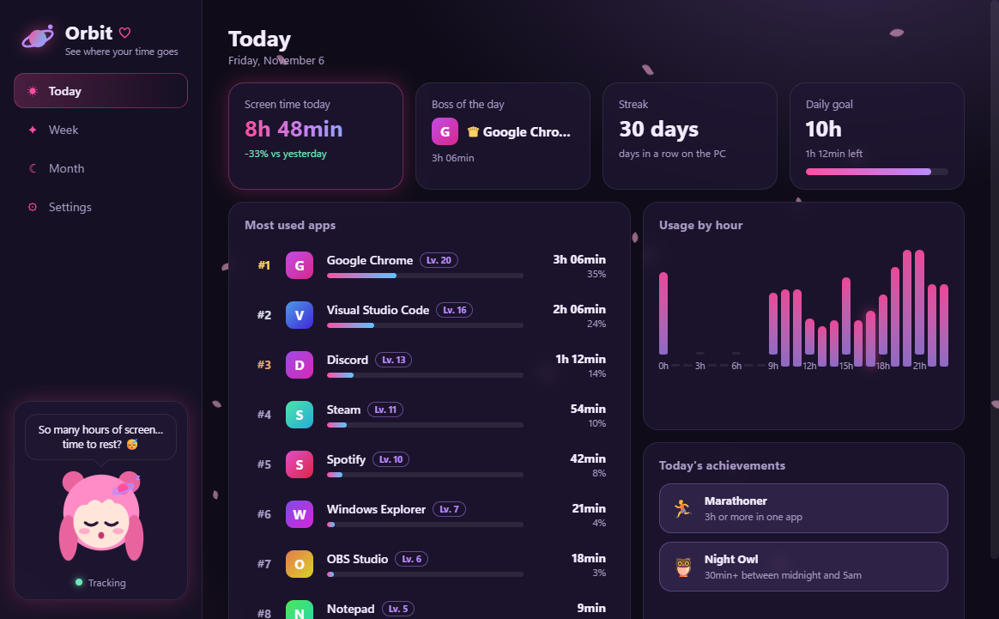
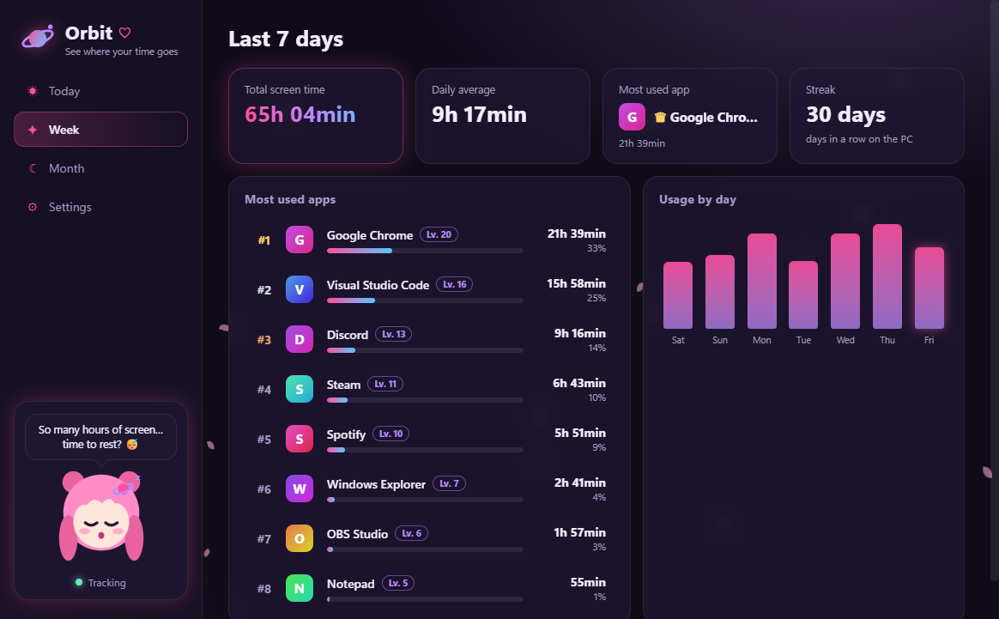
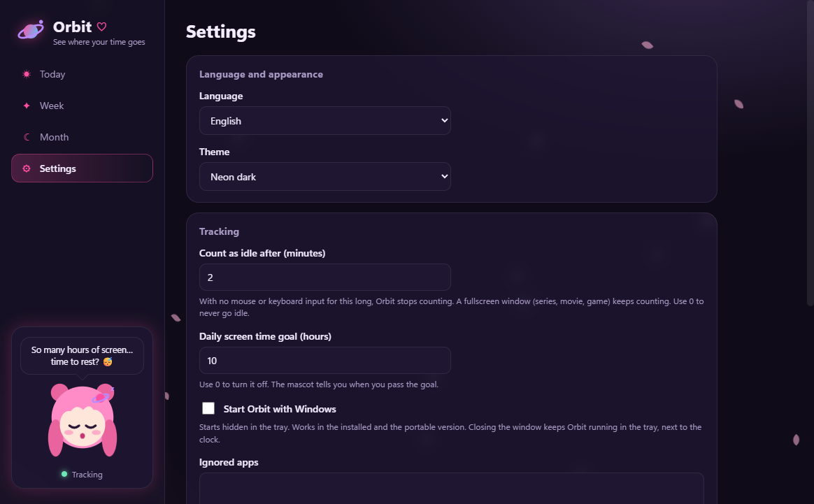

<div align="center">


# Orbit ♡

**See where your time goes.**

Find out which apps you use the most on Windows and how much time you spend in each one, in an app with a neon anime look,
the Luna mascot, a ranking with levels and achievements. Available in English and Portuguese (Brazil).

[Português](README.md) · **English**

[](https://github.com/Maidzinha/orbit/releases/latest)


[](LICENSE.md)



</div>

## Download

Go to **[Releases → latest version](https://github.com/Maidzinha/orbit/releases/latest)** and pick one of the two files:

| File | When to use it |
|---|---|
| **`Orbit-<version>-setup-win-x64.exe`** | To keep it **installed on the PC**, with a Start menu shortcut and an uninstaller |
| **`Orbit-<version>-portable-win-x64.exe`** | **Portable** version: a single `.exe`, installs nothing. Good for trying it out |

**Requirements:** Windows 10 or 11, 64-bit. Nothing else to install.

> **"Windows protected your PC"?** This SmartScreen warning appears because the app has no commercial code signature.
> Click **More info → Run anyway**. To check the download, compare the file's SHA-256 with `SHA256SUMS.txt` in the release.

## How to use

1. Open **Orbit** and use your PC as usual. It starts counting on its own.
2. Close the window whenever you want: Orbit keeps running in the **system tray**, next to the clock. Hover the icon to see today's total.
3. To quit for real, right-click the tray icon and choose **Quit**.
4. In **Settings** you choose the language, theme, idle time, daily goal, ignored apps and whether Orbit starts with Windows.

<p align="center">
  
  
</p>

## What it does

- **App ranking:** today, last 7 days and last 30 days, with icon, name, time and percentage.
- **Charts:** usage by hour (today) and by day (week and month).
- **App details:** click an app to see the last 14 days, the hours you use it most and the all-time total.
- **Smart idle detection:** with no mouse or keyboard input for 2 minutes (configurable), Orbit stops counting. But if the window is **fullscreen** (a series in the browser, a movie, a game), it **keeps counting**. A locked screen and a sleeping PC never count.
- **Game style:** each app earns XP and levels up; the most used app of the day becomes the **Boss of the day**. There are **achievements** like *Marathoner*, *Night Owl*, *Early Bird*, *Explorer* and *Balanced*, plus your **streak** of days in a row.
- **Daily goal:** set a limit in hours and follow it on the progress bar. The mascot tells you when you pass it.
- **Luna the mascot:** reacts to your day (cheerful, focused, sleepy or worried). Click her for another line.
- **Two languages and three themes:** English and Portuguese (Brazil); Neon dark (default), Light and Black & pink. Sakura petals in the background.
- **System tray** and **start with Windows** (optional, starts hidden).
- **CSV export** with the history per day and per app.

## Privacy

- Orbit stores **only the program name** (e.g. `chrome.exe`) and the time spent.
- It does **not read window titles**, websites, file names or keystrokes, and it takes no screenshots.
- Everything stays **on your PC**, in `%AppData%\Orbit\orbit-data.json`. No account, no cloud, no telemetry, no internet.
- You can export or delete the history at any time in **Settings › Your data**.

## Documentation

| | |
|---|---|
| [Changelog](docs/en/CHANGELOG.md) | What changed in each version |
| [Documentação em português](README.md) | README e histórico de versões em português |
| [License](LICENSE.md) | PolyForm Noncommercial 1.0.0 |

## License

Orbit's **source code is public**, under the **[PolyForm Noncommercial License 1.0.0](LICENSE.md)**.

- ✅ **You may:** download it, use it for free, read and study the code, modify it and share copies or modified versions, **for non-commercial purposes** (personal use, study, hobby, schools, non-profits…).
- ❌ **You may not:**
  - sell Orbit or versions of it;
  - include it in a paid product or service;
  - use it for commercial purposes without written permission from the author.
- 📄 Anyone who shares a copy must include the license and the `Required Notice` line at the top of [LICENSE.md](LICENSE.md).
- 💼 Want to use it commercially? Open an [issue](https://github.com/Maidzinha/orbit/issues) to talk about a separate license.

Because it restricts commercial use, Orbit is *source-available*, not "open source" in the [OSI](https://opensource.org/osd) sense.
All of Orbit's artwork (the Luna mascot, the icon, the look) is original and part of the Software.
Third-party components (Electron, koffi…) keep their own licenses.

## Build from source

You need [Node.js](https://nodejs.org/) 20 or newer on Windows.

```bash
git clone https://github.com/Maidzinha/orbit.git
```

```bash
cd orbit
```

```bash
npm install
```

```bash
npm start
```

To run the tests:

```bash
npm test
```

To build the installer and the portable version in `dist\` (runs the tests and draws the icons first):

```bash
npm run dist
```

To redo the images in this README with sample data:

```bash
npm run screenshots
```

<details>
<summary>Project structure</summary>

| Path | What |
|---|---|
| `src/main/main.js` | Main process: tracking loop (1 s), idle detection, tray, IPC, start with Windows |
| `src/main/win32.js` | Reads the foreground window through the Windows API (`user32`/`kernel32` via koffi): only the executable and whether it is fullscreen |
| `src/main/store.js` | Local JSON storage |
| `src/main/demo.js` | Sample data used only for the screenshots |
| `src/shared/stats.js` | Calculations: ranking, totals, levels, streak, achievements, mascot mood, CSV |
| `src/renderer/` | Interface: `app.js`, `style.css` (themes), `i18n.js` (Portuguese and English), `mascot.js` (Luna in SVG) |
| `scripts/make-icons.js` | Draws the app icon as PNG, with no external tools |
| `tests/` | Tests (`node --test`) |
| `docs/` | Images and English documentation (`docs/en`) |

</details>

---

<div align="center"><sub>Orbit · © 2026 Helder (Maidzinha) · non-commercial use ♡</sub></div>
