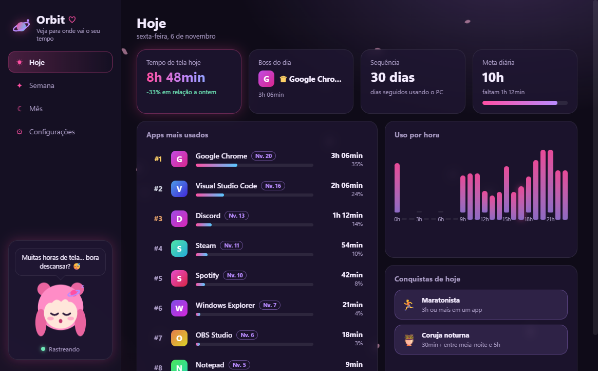
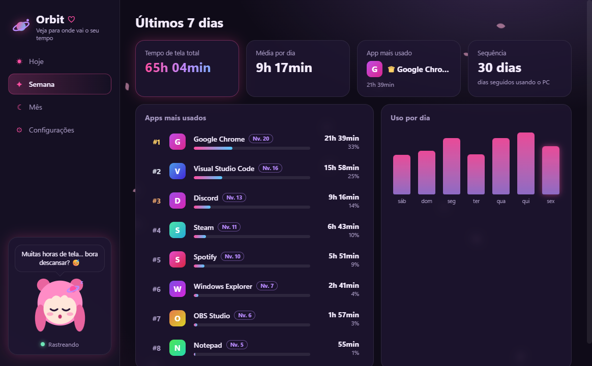
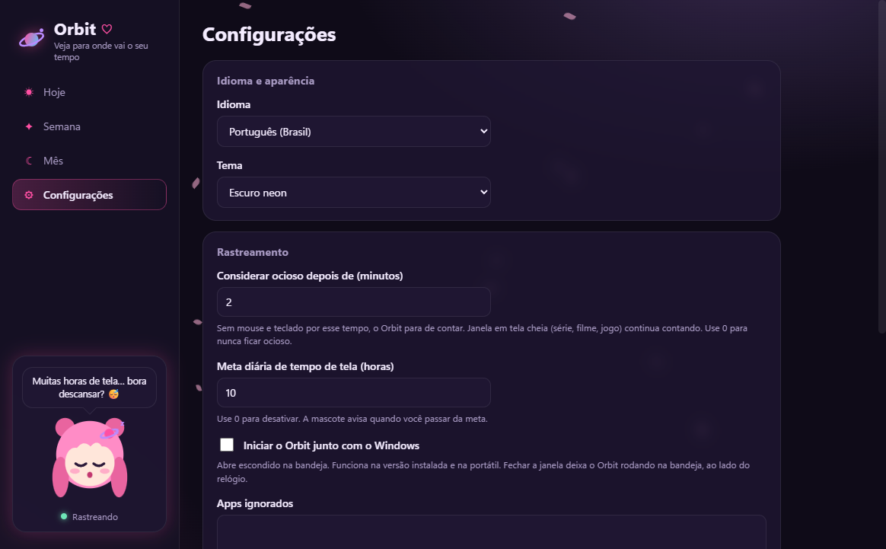

<div align="center">


# Orbit ♡

**Veja para onde vai o seu tempo.**

Descubra quais apps você mais usa no Windows e quanto tempo passa em cada um, num app com visual de anime neon,
a mascote Luna, ranking com níveis e conquistas. Em português (Brasil) e inglês.

**Português** · [English](README.en.md)

[](https://github.com/Maidzinha/orbit/releases/latest)


[](LICENSE.md)



</div>

## Baixar

Vá em **[Releases → última versão](https://github.com/Maidzinha/orbit/releases/latest)** e escolha um dos dois arquivos:

| Arquivo | Quando usar |
|---|---|
| **`Orbit-<versão>-setup-win-x64.exe`** | Para deixar **instalado no PC**, com atalho no Menu Iniciar e desinstalador |
| **`Orbit-<versão>-portable-win-x64.exe`** | Versão **portátil**: um único `.exe`, sem instalar nada. Bom para testar |

**Requisitos:** Windows 10 ou 11, 64 bits. Não precisa instalar mais nada.

> **"O Windows protegeu o computador"?** Esse aviso do SmartScreen aparece porque o app não tem assinatura digital comercial.
> Clique em **Mais informações → Executar assim mesmo**. Para conferir o download, compare o SHA-256 do arquivo com o `SHA256SUMS.txt` da release.

## Como usar

1. Abra o **Orbit** e use o PC normalmente. Ele começa a contar sozinho.
2. Feche a janela quando quiser: o Orbit continua rodando na **bandeja do sistema**, ao lado do relógio. Passe o mouse no ícone para ver o total de hoje.
3. Para sair de vez, clique com o botão direito no ícone da bandeja e escolha **Sair**.
4. Em **Configurações**, você escolhe idioma, tema, tempo de ociosidade, meta diária, apps ignorados e se o Orbit inicia junto com o Windows.

<p align="center">
  
  
</p>

## O que ele faz

- **Ranking de apps:** hoje, últimos 7 dias e últimos 30 dias, com ícone, nome, tempo e porcentagem.
- **Gráficos:** uso por hora (hoje) e por dia (semana e mês).
- **Detalhes do app:** clique em um app para ver os últimos 14 dias, os horários em que você mais usa e o total desde sempre.
- **Ociosidade inteligente:** sem mouse e teclado por 2 minutos (você pode mudar), o Orbit para de contar. Mas se a janela estiver em **tela cheia** (série no navegador, filme, jogo), ele **continua contando**. Tela bloqueada e PC em suspensão nunca contam.
- **Estilo jogo:** cada app ganha XP e sobe de nível; o mais usado do dia vira o **Boss do dia**. Há **conquistas** como *Maratonista*, *Coruja noturna*, *Madrugador*, *Explorador* e *Equilibrado*, e a **sequência** de dias seguidos.
- **Meta diária:** defina um limite de horas e acompanhe na barra de progresso. A mascote avisa quando você passa.
- **Mascote Luna:** reage ao seu dia (animada, focada, sonolenta ou preocupada). Clique nela para outra frase.
- **Dois idiomas e três temas:** português (Brasil) e inglês; Escuro neon (padrão), Claro e Preto e rosa. Pétalas de sakura no fundo.
- **Bandeja do sistema** e **iniciar com o Windows** (opcional, abre escondido).
- **Exportar CSV** com o histórico por dia e por app.

## Privacidade

- O Orbit guarda **só o nome do programa** (ex.: `chrome.exe`) e o tempo de uso.
- Ele **não lê títulos de janela**, sites, nomes de arquivos, teclas digitadas nem tira capturas de tela.
- Tudo fica **só no seu PC**, em `%AppData%\Orbit\orbit-data.json`. Sem conta, sem nuvem, sem telemetria, sem internet.
- Você pode exportar ou apagar o histórico a qualquer momento em **Configurações › Seus dados**.

## Documentação

| | |
|---|---|
| [Histórico de versões](CHANGELOG.md) | O que mudou em cada versão |
| [English documentation](README.en.md) | README e changelog em inglês (`docs/en`) |
| [Licença](LICENSE.md) | PolyForm Noncommercial 1.0.0 (texto oficial em inglês) |

## Licença

O Orbit tem o **código-fonte público**, sob a licença **[PolyForm Noncommercial 1.0.0](LICENSE.md)**.

- ✅ **Pode:** baixar, usar de graça, ler e estudar o código, modificar e compartilhar cópias ou versões modificadas, **para fins não comerciais** (uso pessoal, estudo, hobby, escolas, ONGs…).
- ❌ **Não pode:**
  - vender o Orbit ou versões dele;
  - colocá-lo em produto ou serviço pago;
  - usá-lo para fins comerciais sem autorização por escrito do autor.
- 📄 Quem compartilhar uma cópia precisa incluir a licença e a linha `Required Notice` que está no topo do [LICENSE.md](LICENSE.md).
- 💼 Quer usar comercialmente? Abra uma [issue](https://github.com/Maidzinha/orbit/issues) para conversar sobre uma licença separada.

Como restringe o uso comercial, o Orbit é *source-available* (código disponível), e não "open source" no sentido da [OSI](https://opensource.org/osd).
O texto oficial da licença é em inglês e é ele que vale. Toda a arte do Orbit (mascote Luna, ícone, visual) é original e faz parte do Software.
Os componentes de terceiros (Electron, koffi…) continuam com as licenças deles.

## Compilar a partir do código

É preciso o [Node.js](https://nodejs.org/) 20 ou mais novo no Windows.

```bash
git clone https://github.com/Maidzinha/orbit.git
```

```bash
cd orbit
```

```bash
npm install
```

```bash
npm start
```

Para rodar os testes:

```bash
npm test
```

Para gerar o instalador e a versão portátil em `dist\` (roda os testes e desenha os ícones antes):

```bash
npm run dist
```

Para refazer as imagens deste README com dados de exemplo:

```bash
npm run screenshots
```

<details>
<summary>Estrutura do projeto</summary>

| Caminho | O quê |
|---|---|
| `src/main/main.js` | Processo principal: laço de rastreamento (1 s), ociosidade, bandeja, IPC, iniciar com o Windows |
| `src/main/win32.js` | Lê a janela em primeiro plano pela API do Windows (`user32`/`kernel32` via koffi): só o executável e se está em tela cheia |
| `src/main/store.js` | Armazenamento local em JSON |
| `src/main/demo.js` | Dados de exemplo usados só nas capturas de tela |
| `src/shared/stats.js` | Cálculos: ranking, totais, níveis, sequência, conquistas, humor da mascote, CSV |
| `src/renderer/` | Interface: `app.js`, `style.css` (temas), `i18n.js` (português e inglês), `mascot.js` (Luna em SVG) |
| `scripts/make-icons.js` | Desenha o ícone do app em PNG, sem ferramentas externas |
| `tests/` | Testes (`node --test`) |
| `docs/` | Imagens e documentação em inglês (`docs/en`) |

</details>

---

<div align="center"><sub>Orbit · © 2026 Helder (Maidzinha) · uso não comercial ♡</sub></div>
